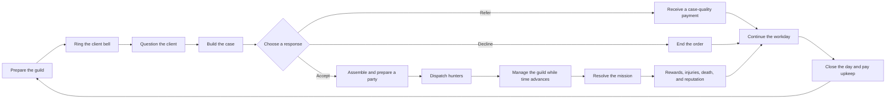

# Adventurers' Guild Manager — Game Design Document

**Document purpose:** This document defines the intended player experience, gameplay rules, and relationships between the game's systems. It describes what the player does and why those actions matter. Implementation details, asset setup, and production tasks belong in the project's technical documentation and release plan.

Balance values in this document describe the current design and may change during playtesting.

---

## 1. High Concept

**Adventurers' Guild Manager** is a first-person fantasy management game in which the player runs a monster-hunting guild. Clients arrive with incomplete reports. The player questions them, turns their answers into clues, identifies the monster, and decides whether to accept, refer, or decline the contract. Accepted jobs require the player to assemble a suitable party from a roster of named hunters and prepare them using the guild's facilities.

The player never controls combat directly. Their decisions before and during dispatch determine whether hunters return victorious, wounded, or dead. Money, reputation, facilities, equipment, and the condition of the guild shape the next decision.

### Player fantasy

The player should feel like the person responsible for a living guild: part investigator, part strategist, part employer, and part caretaker. They learn the strengths and failings of individual hunters, become better at reading cases, and gradually turn a vulnerable guild into a respected institution.

### Genre and format

- First-person management and investigation game
- Single-player
- Session-based days inside a persistent campaign
- Simulated missions with no player-controlled combat
- Character-driven fantasy with serious consequences

---

## 2. Design Pillars

### Knowledge creates an advantage

The player is rewarded for asking useful questions and interpreting evidence correctly. A well-built case improves the quality of every later decision: whether to take the job, which hunters to send, and what preparations they need.

### Hunters are people, not disposable units

Every hunter has a name, appearance, personality, traits, experience, upkeep cost, and physical state. Injuries and death persist. The player should remember individual hunters because of the stories created by their successes, mistakes, rivalries, and narrow escapes.

### Every useful action competes for time

The workday is an action budget. Questioning a client, treating an injury, recruiting a hunter, briefing a party, cleaning the hall, and preparing facilities all consume time. The central pressure comes from choosing what deserves attention today.

### The guild is a place the player inhabits

Management happens by walking through the guild and using its rooms, objects, and characters. Facilities should feel like parts of a workplace rather than abstract menu bonuses. The state of the building visibly reflects the player's decisions.

### Risk creates stories

The game gives the player forecasts and evidence, but rarely complete certainty. A strong plan should improve the odds without erasing danger. Success, wounds, death, debt, and unexpected rewards create memorable outcomes that feed back into the campaign.

---

## 3. Core Gameplay Loop

The main loop is a sequence of investigation, commitment, preparation, and consequence.

### The contract loop

1. A client presents a report about a monster problem.
2. The player asks questions to reveal clues and information about the monster's traits.
3. The player opens the Case Builder, assigns clues to their categories, and narrows the list of possible monsters.
4. The player selects the monster they believe is responsible.
5. The player accepts the contract, refers it to another guild, or declines it.
6. For an accepted contract, the player chooses one to three hunters and prepares them.
7. The party departs while the player continues managing the guild.
8. The mission resolves according to the monster, party, preparation, and accumulated modifiers.
9. The result changes the guild's money, reputation, trust, roster, and future options.

### The campaign loop

Successful days provide the resources and reputation needed to recruit better hunters, improve existing hunters, construct and upgrade facilities, acquire equipment, and take more dangerous contracts. More difficult work produces greater rewards but exposes valuable hunters to greater risk. The campaign repeatedly asks the player how quickly they are willing to grow and how much risk they will accept to do it.

---

## 4. Structure of a Day

### Preparation phase

Before opening the guild to clients, the player can inspect the roster, assign beds and equipment, plan facility use, review finances, and claim an available reputation promotion. This is a low-pressure planning phase.

### Active workday

The player rings the bell to begin receiving clients. The active day has a current target of **600 action seconds**. Time is spent by meaningful activities rather than by simply standing still. This lets the player think at their own pace while preserving pressure around how many tasks can be completed.

Actions that may consume time include:

- Asking clients questions
- Reviewing and committing an order
- Recruiting or dismissing hunters
- Briefing and feeding a party
- Treating wounded hunters
- Cleaning the guild
- Preparing and dispatching hunters

Dispatched missions also progress through action time. Sending a party late in the day can leave less time for the mission and can impose a late-dispatch penalty.

### Evening and resolution

At the end of the active day, unfinished missions are resolved, daily effects expire, and the player prepares the guild for sleep. Hunter upkeep is charged as the next day begins. The financial result of the day therefore matters immediately.

---

## 5. Clients, Questions, and Clues

Clients describe monster incidents through dialogue. Their reports are deliberately incomplete, and their answers turn vague testimony into usable evidence.

Questions reveal two kinds of information:

- **Clues** describe observable features used to identify the monster.
- **Trait information** describes behavior or abilities that affect the danger of the mission.

Revealed clues remain visible in the dialogue panel so the player can review the conversation without memorizing it. They also become available in the Case Builder.

Clients may communicate at different speeds. A difficult or slow conversation consumes more of the workday, creating a reason to choose questions carefully instead of exhausting every dialogue option by default.

### Clue categories

The current identification model uses six categories:

- Family
- Size
- Sound
- Tail
- Wings
- Movement

Not every case must reveal all six categories. The player can commit to a conclusion with partial evidence, but doing so increases the chance of an incorrect declaration.

---

## 6. The Case Builder

The Case Builder is the player's main reasoning space. It replaces the old passive order view and combines the evidence, suspected monster, client information, and contract decision in one screen.

The board contains:

- One clue slot for each evidence category
- Every clue revealed during the conversation
- A browsable list of monster candidates with names and portraits
- The information required to accept, refer, or decline the order

The player can click a clue or drag it into the appropriate category slot. Assigned clues filter the candidate list to monsters that match the current case. The remaining list is evidence, not an automatic answer: several monsters may fit an incomplete case.

Clicking a monster selects and highlights it as the current declaration. Clicking the selected monster again clears the selection. Committing the case records the player's chosen monster, which may differ from the monster actually responsible.

The design should make three states visually distinct:

- What the client has revealed
- What the player has assigned to the case
- What the player has concluded

The player should always understand why a monster remains in or has disappeared from the candidate list.

---

## 7. Contract Decisions

Once the player has declared a monster, they choose how the guild responds.

### Accept

The guild takes responsibility for the hunt. The player assembles a party, prepares it, and accepts the possibility of failure, injuries, and death in exchange for the full reward and progression benefits.

### Refer

The guild sends the case to another organization. Referral produces a smaller immediate payment based on the quality of the case. Better-supported identifications are worth more. Repeated referrals within the same day have diminishing value, preventing referral from becoming a risk-free dominant strategy.

### Decline

The guild refuses the order. No party is placed at risk, but the player receives no contract reward or mission progress.

These choices allow players to manage risk. A weak roster, dangerous monster, injured specialist, or poor financial position can make the safest response different from the most profitable one.

---

## 8. Party Assembly and Preparation

Accepted contracts require a party of **one to three hunters**. The player compares the demands of the suspected monster with the available roster.

The decision considers:

- Hunter power and level
- Personal traits, strengths, and weaknesses
- Traits that counter or are countered by the monster
- Party size
- Current wounds and fatigue-related conditions
- Equipment traits
- Food, briefing, and facility bonuses
- Time remaining before dispatch
- The guild's wider financial situation

The game presents a useful forecast, but the forecast should not remove all uncertainty. The player's main skill is learning which modifiers matter enough to justify their time and money.

### Preparation choices

Preparation can raise the chance of success or reduce the severity of failure. It should never be a compulsory checklist with one correct sequence. A player may invest heavily in one dangerous mission, send an efficient specialist with minimal support, or preserve resources for later clients.

---

## 9. Mission Progress and Resolution

After dispatch, a party leaves the guild and the mission advances while the player completes other actions. A guild map shows dispatched parties and their progress, creating anticipation and helping the player understand how many commitments remain active.

The map is an information and storytelling surface. It should show where parties are, how far they have progressed, and which contracts are approaching resolution without becoming a separate tactical combat system.

### Outcome tiers

Missions can produce several meaningful results:

- **Clean success:** The party completes the hunt convincingly. This provides the strongest trust and reputation benefit and protects hunters from serious consequences.
- **Messy success:** The monster is defeated, but the party's performance carries reduced rewards, weaker trust gains, or greater risk of injury.
- **Failure:** The contract is not completed. Hunters may return wounded, die, or suffer other consequences, and the guild loses standing.

Strong performance can also produce bonus treasure. Chests may contain equipment or reveal a mimic, turning a reward into another piece of the game's monster-hunting fiction.

The resolution screen should explain the most important causes of the result. The player needs enough feedback to form a better plan next time without seeing the experience reduced to an opaque formula.

---

## 10. Hunters

Hunters are the player's principal long-term investment and the emotional center of the guild.

Each hunter can have:

- A name, portrait, and 3D appearance
- Rarity and recruitment requirements
- Power, level, and experience
- A set of defining traits
- A daily upkeep cost
- Equipment slots
- Dialogue and personality
- A current state, such as available, dispatched, wounded, recovering, or dead
- A personal place and pose within the guild

### Traits

Traits connect the character system to the rest of the game. They can affect mission success, monster matchups, the guild economy, injury rules, preparation, or other hunters. Traits should create recognizable specialties rather than small interchangeable percentage changes.

### Recruitment

The player spends resources to advertise for hunters. A recruitment campaign produces candidates who can be reviewed, hired, or declined. Hiring expands the guild's options but also increases daily upkeep. The best candidate is therefore not automatically the best financial choice.

### Growth

Hunters gain experience from missions and can improve over time. Level advancement, better equipment, and successful specialization let familiar characters remain valuable as the guild reaches harder content.

### Injury and death

Wounds reduce the availability or effectiveness of hunters and may require treatment in the infirmary. Death is persistent. A dead hunter is removed from active play and remembered in the graveyard. This consequence supports the game's central promise that staffing decisions matter.

---

## 11. Equipment

Equipment is both loot and a way to reshape a hunter's role.

- Hunters have typed equipment slots, with two slots as the current default.
- Each slot accepts only the associated category, such as a weapon or armor.
- Equipped items grant traits that become part of the hunter's active build.
- Removing an item removes its granted traits.
- A physical copy can be equipped by only one hunter at a time.
- Duplicate copies increase the number of hunters who can use that item.

Equipment is assigned in the Armory through drag-and-drop or direct selection. If the player selects a copy already used by another hunter, the game warns that it will be moved before making the change.

The Equipment List acts as a collection catalogue. Items are grouped by category and sorted alphabetically, with owned items shown first. Each entry presents its icon, description, owned quantity, and granted traits. Undiscovered equipment remains visible in a concealed state to communicate that more items exist.

Equipment should create new party-building options. It should not simply replace one item with a numerically superior version at every step.

---

## 12. Monsters and the Bestiary

Monsters are both investigation subjects and mission challenges.

Each monster has:

- A family and identification tags
- Traits that affect the hunt
- A difficulty or power expectation
- Visual identity, portrait, and descriptive text
- Rewards and progression requirements

The Bestiary records discovered monsters and lets the player study them outside an active case. Monsters are divided into families, making the catalogue useful both as a reference and as a record of progress. Trophy displays provide a physical reminder of completed hunts inside the guild.

The identification tags and combat traits should support different forms of mastery. A player may learn to recognize a monster from a small set of clues while still needing to inspect its traits before choosing a party.

---

## 13. Guild Facilities

Facilities convert time, money, and attention into advantages. Their value comes from the decisions they enable during a busy day.

### Construction and upgrades

The player builds rooms and improves the guild as reputation and finances grow. Construction unlocks new options and strengthens existing systems. Upgrades should visibly change the guild so progression can be felt while walking through it.

### Kitchen

The kitchen prepares limited servings of food. Recipes grant daily bonuses or useful counters. The player chooses who receives a serving and whether the benefit is worth the preparation cost. Used dishes create cleanup work.

### Dormitory

Hunters need assigned beds and adequate rest. Neglected or dirty beds can create penalties, while a well-managed dormitory supports recovery and readiness.

### Infirmary

Wounded hunters can be treated by spending action time. Treatment competes directly with client work and other preparation, forcing the player to decide how quickly an important hunter must return.

### Briefing room

The player gathers a party and conducts a briefing using the chalkboard. The quality and duration of the briefing grant a daily mission bonus. This makes preparation a physical interaction and gives dispatched groups a short moment of shared identity.

### Armory

The Armory is the place for reviewing hunters' equipment, comparing traits, and assigning owned items.

### Main hall cleanliness

Dirt accumulates in the guild and affects its condition and rewards. The player can clean visible dirt using a broom. Cleaning takes a consistent amount of real time, while its action-time cost reflects the amount of dirt removed. This keeps the interaction readable while preserving its strategic cost.

### Trophy wall and graveyard

The trophy wall celebrates monster victories. The graveyard records the hunters lost under the player's command. Together they make the campaign's history visible in the physical guild.

---

## 14. Economy, Reputation, and Trust

### Gold and upkeep

Gold comes primarily from completed contracts, referrals, and rewards. It is spent on hunter upkeep, recruitment, treatment, construction, upgrades, and other guild services.

Existing debt is paid before new income becomes available for spending. This prevents a struggling guild from escaping its obligations through a single lucky reward.

Every active hunter adds daily upkeep. If the player cannot pay, the guild enters an escalating financial crisis:

1. The first unpaid day applies immediate penalties.
2. Continued non-payment damages reputation and restricts staffing choices.
3. Three consecutive unpaid days end the campaign.

The warning must be clear before the player ends a day they cannot afford.

### Reputation

Reputation represents the guild's long-term standing. It unlocks more dangerous monsters, stronger recruitment candidates, construction options, and broader progression. The current structure contains six ranks.

Earning enough reputation points makes a promotion available, but the player claims the new rank manually during the preparation phase. Promotion should feel like a deliberate milestone.

### Trust streak

Clean successes build a trust streak, currently capped at five. Failures and poor results reduce or reset it. Trust creates short-term momentum and gives the player a reason to protect a sequence of reliable performances instead of taking every available risk.

---

## 15. Progression

Progress happens across three connected timescales.

### Within a day

The player reveals information, prepares parties, responds to mission results, treats injuries, and decides which remaining tasks deserve the day's limited time.

### Across several days

Hunters gain experience, the roster changes, equipment accumulates, facilities improve, debt rises or falls, and the player becomes familiar with recurring monster patterns.

### Across the campaign

Reputation ranks unlock harder cases and better opportunities. The guild becomes more capable and visually established, while permanent losses and trophies record the player's history.

Progression should widen the decision space rather than remove earlier pressures. A richer guild gains stronger tools but also carries a larger payroll, more valuable hunters, and more difficult responsibilities.

---

## 16. Story and NPCs

The story is delivered through the people who use and inhabit the guild: clients, hunters, recurring NPCs, and staff. The demo should contain a short narrative arc that introduces the setting, creates a personal stake, and reaches a clear payoff while the player continues performing the normal management loop.

Story scenes should support the player's role as guild manager. They may introduce unusual contracts, change access to a facility, reveal information about a hunter, or force a difficult risk decision. They should rarely suspend the core game for long stretches.

Named hunters should react to their own history where practical. A wounded survivor, a successful specialist, and a hunter who lost a companion should feel different from newly generated resources.

---

## 17. Optional Guild Activities

Small activities can add rhythm and character between high-pressure decisions. The card game is the current example of a social guild activity. Optional activities should either deepen relationships, offer a modest strategic consequence, or provide a deliberate moment of rest. They should not compete with the central investigation and party-management loop unless their purpose is clear.

---

## 18. Information and Interface Principles

The game contains many connected modifiers, so clarity is part of the design rather than a final presentation layer.

### Show the source of decisions

The player should be able to trace a forecast back to monster traits, hunter traits, equipment, facilities, wounds, and time penalties.

### Separate facts from conclusions

The interface must distinguish revealed evidence, assigned clues, suspected identity, and the true mission result. This preserves the pleasure of deduction and makes mistakes understandable.

### Explain unavailable actions

Locked facilities, invalid equipment, unaffordable hires, and unavailable hunters should state why they cannot be used and what would make them available.

### Keep consequences visible

Current gold, expected upkeep, action time, active missions, wounded hunters, and financial danger should be readable before the player commits to an irreversible decision.

### Support comparison

Hunter, monster, and equipment views should make related traits easy to compare. The player should spend time making a decision, not remembering which screen contained the relevant fact.

---

## 19. Presentation Direction

The guild uses a stylized, low-poly fantasy presentation with strongly readable silhouettes and character designs. Custom hunters should preserve individual identity while sharing a consistent scale, animation language, and material style.

Faces use graphic 2D eyes and mouths on 3D characters. Blinking, eye movement, and mouth changes during printed dialogue make characters feel responsive without changing the visual style. Hair and clothing movement add secondary motion and help the new character models feel alive.

Sound should communicate both atmosphere and state: client arrival, clue discovery, case assignment, dispatch, mission return, rewards, injuries, construction, cleaning, and financial warnings all need recognizable feedback. Ambient guild activity should make quiet management moments feel inhabited.

---

## 20. Onboarding

The opening sequence should teach the full contract loop before introducing the wider management burden.

1. Meet a client and ask a question.
2. Reveal and review a clue.
3. Use the Case Builder to narrow the candidates.
4. Declare a monster and accept the order.
5. Inspect hunters and choose a party.
6. Prepare and dispatch them.
7. Observe mission progress and resolve the result.
8. End the day and understand upkeep.

Facilities, recruitment, equipment, and more dangerous consequences can then be introduced in smaller steps. Tutorial guidance should explain the goal of an action while leaving the player responsible for performing it.

---

## 21. Demo Experience

The demo should prove the complete fantasy of operating a monster-hunting guild. It needs enough breadth for the player to form strategies and enough authored content for the guild to feel personal.

### Content target

- 30 monsters with identification clues, traits, visuals, and rewards
- 37 hunters with distinct traits, visuals, dialogue, and progression
- An equipment pool obtained through rewards, chests, and mimics
- A short story arc with recurring NPCs
- Updated UI and a complete sound pass for the core loop
- Individual guild positions and poses that give hunters visible personality

### Required player journey

During the demo, the player should:

- Complete several full investigation-to-resolution loops
- Make at least one uncertain identification decision
- Experience the difference between a clean and messy result
- Recruit or develop a hunter
- Use multiple facilities to prepare or recover a party
- Acquire and equip an item that changes a hunter's role
- See a dispatched party progress on the map
- Face meaningful financial pressure
- Reach a clear narrative and progression milestone

The demo's ending should leave the player with a sense that their guild has changed because of their choices and that the next reputation tier would introduce harder responsibilities.

---

## 22. Balance Principles

- Better information should improve decisions without guaranteeing success.
- Preparation should be valuable, but no single preparation routine should solve every mission.
- Small parties should be efficient and risky; larger parties should be safer and more expensive.
- Specialist hunters should be powerful in the right matchup and imperfect elsewhere.
- Referral should be useful when the guild is unprepared, but less profitable than well-executed hunts.
- Failure should hurt without making recovery impossible after one ordinary mistake.
- Permanent death should result from understood risk, not unexplained randomness.
- Facility maintenance should create tradeoffs without turning the game into repetitive housekeeping.
- New reputation ranks should introduce decisions as well as larger numbers.

---

## 23. Open Design Decisions

These questions should be settled through design review and playtesting before the demo is content-complete:

- What exact milestone ends the demo: a reputation rank, a story contract, a fixed number of days, or a combination?
- How much of the monster catalogue is initially known, and how quickly does the Bestiary reveal hidden information?
- How many equipment categories and items are needed for the demo to support distinct builds?
- How interactive should the mission map be beyond inspecting progress and party details?
- What strategic or relationship purpose should the card game serve in the demo?
- How frequently should wounds and deaths occur at the level of risk the interface describes as normal?
- Which consequences carry between story beats, and which can be recovered through ordinary guild play?

---

## 24. Design Success Criteria

The core design is working when players can answer the following questions after a session:

- What evidence led me to identify that monster?
- Why did I choose those hunters?
- Which preparation changed the outcome?
- What did the mission cost my guild, even if it succeeded?
- Which hunter do I care about, and why?
- What am I trying to improve before the next day or reputation rank?

If players understand their decisions, care about the people affected by them, and want to attempt one more case with a better plan, the central loop is delivering the intended experience.
